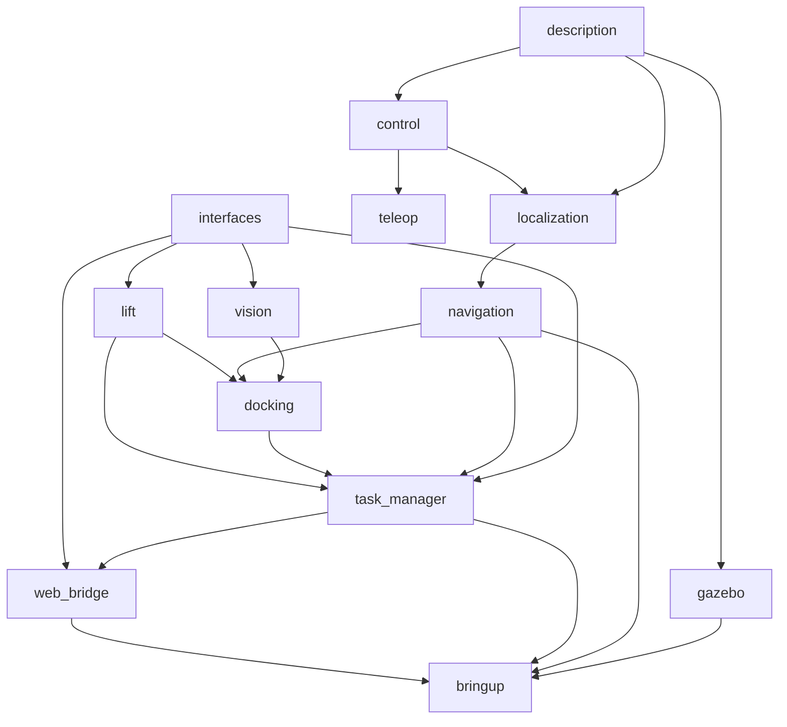
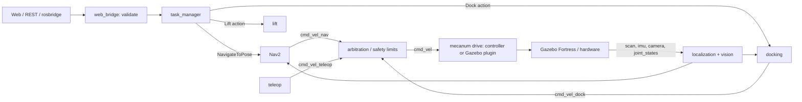

# 01 - Project Architecture

## 1. Purpose
Define what the system is for, how it is split into ROS 2 packages, how data flows, and which decisions are settled or open. This file is the single source of truth for package responsibilities. Milestone details live in `docs/development/roadmap.md`; live progress in `docs/development/status.md`.

## 2. System objectives
An autonomous mobile robot (AMR) forklift with **four mecanum wheels** (holonomic: vx, vy, wz) and a **fork lift** mechanism that can map, localize, navigate warehouse routes, detect and dock with pallets/stations, execute missions, and be monitored/commanded from a web dashboard. Development is **simulation-first** (Gazebo Fortress); physical hardware is a later milestone (16).

Non-goals for now: hardware drivers, fleet-level traffic management, cloud services.

## 3. Environment (fixed)
Ubuntu 22.04, ROS 2 Humble, Gazebo Fortress (Ignition Gazebo 6), Python + C++, one colcon workspace at the project root with packages in `src/`. See ADR-0001.

## 4. Current baseline (inspected 2026-11-02, status: unverified)
Already present in `src/` (created before this skill; preserve):

| Package | Build type | Contents found |
|---|---|---|
| `mecanum_forklift_description` | ament_cmake | Xacro model (base, 4 mecanum wheels, prismatic fork, lidar, front camera), STL/DAE meshes, `display.launch.py`, RViz config. `urdf/gazebo.xacro`, `material.xacro`, `ros2_control.xacro` are **empty (0 bytes)**; materials are defined inline in `mecanum_forklift.urdf.xacro` |
| `mecanum_forklift_gazebo` | ament_cmake | `empty.sdf`, `simple_warehouse.sdf`, 7 SDF models (shelf, pallet, stations, cone, box), `bridge_config.yaml`, launch that converts Xacro->SDF and spawns |
| `mecanum_forklift_teleop` | ament_python | `keyboard_node.py`, `ps4_node.py`, `ps4.yaml`, `ps4_teleop.launch.py` |

Current drive path: **Gazebo `MecanumDrive` system plugin** (not ros2_control) consuming `/cmd_vel`, publishing `/odom` and TF; fork via Gazebo `JointPositionController` on `/fork/cmd_pos`. See ADR-0002 for the open question of keeping this vs ros2_control.
None of this has been re-built or run by the skill author; treat as *implemented, build status per colcon logs, not verified*.

## 5. Package responsibilities

Existing (E) and planned (P) packages. Names follow `mecanum_forklift_<role>`. Planned packages are **proposals** - create only after architecture approval (Milestone 2).

| Package | | Responsibility |
|---|---|---|
| `mecanum_forklift_description` | E | URDF/Xacro, meshes, RViz |
| `mecanum_forklift_gazebo` | E | worlds, models, spawn, ros_gz bridge |
| `mecanum_forklift_teleop` | E | keyboard/PS4 -> velocity + fork commands |
| `mecanum_forklift_interfaces` | P | custom msgs/srvs/actions (ament_cmake only) |
| `mecanum_forklift_control` | P | ros2_control config / custom mecanum components, velocity arbitration (twist_mux config) |
| `mecanum_forklift_localization` | P | EKF, AMCL/SLAM configs |
| `mecanum_forklift_navigation` | P | Nav2 params, maps, behavior trees, routes |
| `mecanum_forklift_lift` | P | lift controller + hardware abstraction |
| `mecanum_forklift_vision` | P | ArUco / pallet detection, pose transforms |
| `mecanum_forklift_docking` | P | dock database, docking state machine |
| `mecanum_forklift_task_manager` | P | task/mission action servers |
| `mecanum_forklift_web_bridge` | P | REST API, command validation, rosbridge/video launch |
| `mecanum_forklift_bringup` | P | launch composition, namespaces, per-robot params |

The reference repo splits similarly (`forklift_*`), plus safety, diagnostics and traffic manager packages. Whether to add `safety`/`diagnostics` is an **open decision** (Q3).

## 6. Dependency graph (planned)

Rule: no cycles; `interfaces` and `description` are leaf dependencies; only `bringup` depends on everything.

## 7. Data flow (target)

## 8. Simulation-first strategy
1. Every subsystem must reach "verified in simulation" with recorded evidence before hardware work.
2. Interfaces to hardware (wheel commands, lift, sensors) are kept behind ROS topics/ros2_control hardware interfaces so sim and real differ only by launch/params.
3. Simulation passing is never evidence of physical safety (see 10, 15).

## 9. Development milestones
16 milestones; table of IDs here, details in `docs/development/roadmap.md`: 1 Requirements & reference analysis - 2 Architecture - 3 Robot description - 4 Gazebo simulation - 5 Mecanum control & teleop - 6 Odometry & TF - 7 SLAM - 8 Localization - 9 Navigation - 10 Forklift control - 11 Vision & docking - 12 Mission management - 13 Web integration - 14 Bringup & multi-robot - 15 Integration & regression - 16 Hardware.
Existing code overlaps milestones 3-5; those milestones begin with an **audit** of the existing package, not a rewrite.

## 10. Architectural decisions
Recorded in `docs/decisions/`. Format: Decision, Reason, Alternatives, Consequences, Verification needed.
- ADR-0001 Target environment fixed (accepted).
- ADR-0002 Drive stack: Gazebo plugin vs ros2_control `mecanum_drive_controller` (**proposed, undecided**).
- ADR-0003 Reference repo reuse policy (accepted).

## 11. Unresolved questions
- Q1 Drive stack for sim (ADR-0002) and whether it must match the future hardware interface.
- Q2 Single vs separate `interfaces` package timing - propose creating it at Milestone 2/10 when first needed.
- Q3 Include safety/diagnostics packages (reference has them) now or later?
- Q4 Wheel layout and roller orientation of the real robot (assumed X pattern from Gazebo example; confirm with hardware drawings).
- Q5 Real lift hardware (stroke, encoder, driver) - current model has 0.12 m prismatic travel.
- Q6 Camera/depth sensor choice for pallet detection; GPU availability for YOLO.
- Q7 Number of robots to support in simulation.

## 12. Verified resources
- Reference repo: https://github.com/boyloy21/autonomous-mini-forklift (shallow-cloned and read on 2026-11-02; 17 packages; Humble + Fortress; differential drive).
- Local inspection results above.
