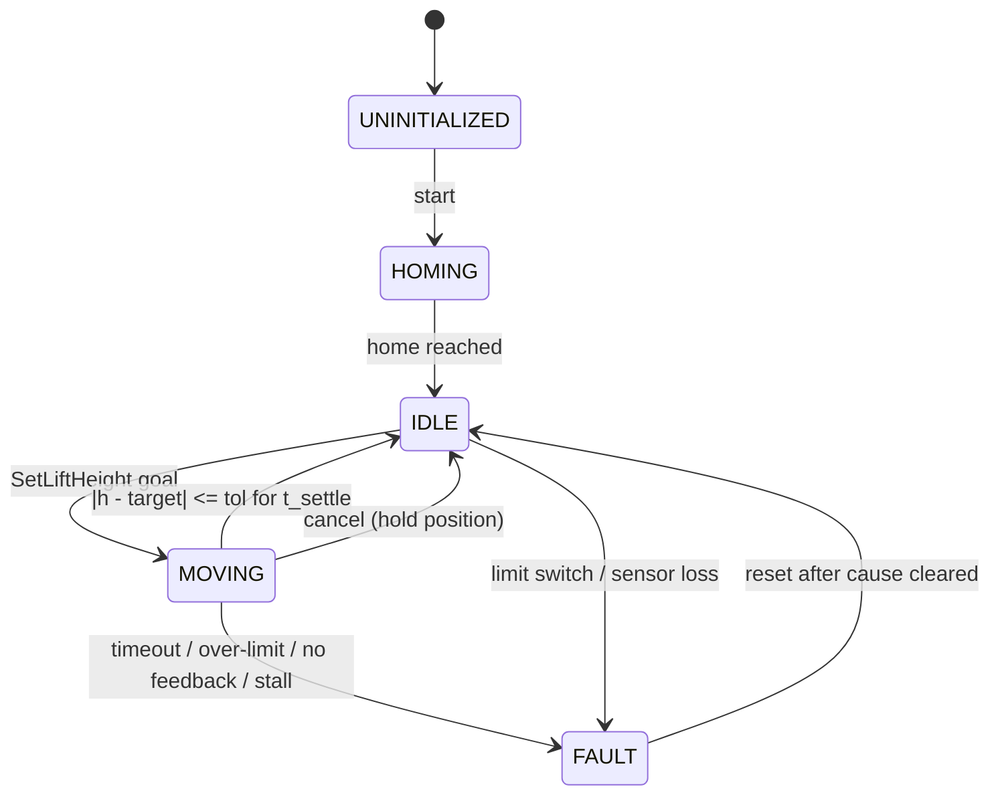

# 10 - Forklift (Lift) Control

## 1. Purpose
Control of the fork/lift mechanism with explicit states, limits, feedback and faults, behind an abstraction that serves both simulation and future hardware.

## 2. Current state
Updated 2026-11-14: `mecanum_forklift_lift` implements section 4 for simulation (ADR-0008, docs/testing/2026-11-14_m10_lift_control.md); teleop commands go through `fork/cmd_teleop`; Gazebo PID is now 5000/50/150. The notes below are the 2026-11-02 inspection.

### Inspected 2026-11-02 (before M10)
- Model: `fork_joint` prismatic, travel `fork_lift_max` = 0.12 m, fork mass 0.5 kg (a scale-model robot).
- Sim control: Gazebo `JointPositionController` on topic `fork/cmd_pos` (`std_msgs/Float64`, metres), PID gains p 1000, i 20, d 50; bridged ROS<->Gazebo. Joint state published by `JointStatePublisher` on `/joint_states`.
- Teleop publishes fork targets directly with `fork_min/max` clamp.
- No state machine, no limit/fault logic, no action interface.

## 3. Reference repo design (to review, not copy)
`forklift_controller` is split into controller, driver, feedback, limit and safety nodes; ros2_control `lift_position_controller`; prismatic lift 0 - 1.2 m; `SetLiftHeight` action; driver may use a serial port with a `use_hardware` flag. Different scale and a different actuator; validate any assumption.

## 4. Proposed architecture

- **Interface**: action `SetLiftHeight` (target m, optional speed) -> result (reached height, error code); state topic (height, velocity, state, fault code); optional service `ResetFault`.
- **Hardware abstraction**: one node exposing the same ROS interface; backends: Gazebo joint controller (sim), ros2_control/serial driver (hardware). Selected by launch arg.
- **Limits**: software min/max, velocity/acceleration limits, payload-dependent limit (TBD), travel only when robot speed below threshold (coordination with 12). 
- **Feedback**: joint state (sim); encoder + limit switches (hardware, TBD). If no feedback exists, the lift is open-loop and must be reported as such.
- **Faults**: command timeout, no feedback, stall (commanded vs actual), over-limit, safety stop -> stop motion, latch FAULT, report code.

## 5. Tests
Sim: command 0 -> 0.06 -> 0.12 -> 0; measure settling time, overshoot, steady-state error; command beyond limits is rejected/clamped; cancel mid-move holds; kill feedback source -> FAULT; recovery after reset; fork under load (pallet model) if M11 models are available.
Acceptance (M10): reached-height error <= TBD mm, no overshoot beyond limits, all fault paths tested, state/telemetry published at documented rate.

## 6. Failure modes
Oscillation with PID gains (tune relative to mass); fork sinks under load (gravity compensation/effort limits); joint limit in URDF disagrees with software limit; camera on the carriage moves with the fork - vision transforms must include fork height (11).

## 7. Documentation
State table, fault code table, params, tuning results, hardware abstraction spec, "simulation does not validate physical safety" note.

## 8. Open
Real actuator and sensors; payload mass; speeds; interlocks with driving.
