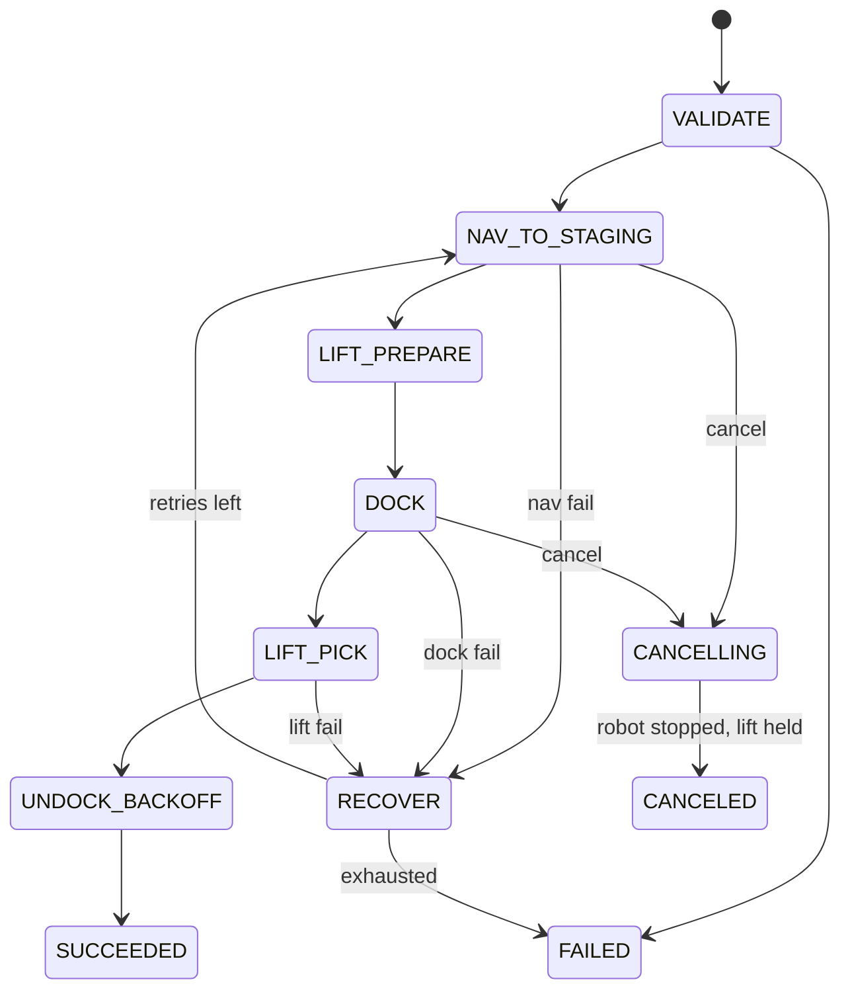

# 12 - Task and Mission Management

## 1. Purpose
Orchestrate navigation, docking and lift operations into tasks and missions with predictable behaviour under failure.

## 2. Model
- **Task**: one atomic workflow, e.g. `NAVIGATE`, `PICK_PALLET`, `DROP_PALLET`, `CHARGE`, `WAIT`.
- **Mission**: ordered list of tasks with an id, priority, and failure policy.
- Reference repo layering (review, reuse concepts): `forklift_mission_manager` (`ExecuteMission` action) -> `forklift_task_manager` (`ExecuteTask` action) -> Nav2 `NavigateToPose`, docking actions, `SetLiftHeight`. Task types there: SINGLE_NAVIGATION, PATROL_POINT, PICK_PALLET_DOCK, DROP_PALLET_DOCK, CHARGING_DOCK, STATION_DOCK.
- Implementation options: plain state machine in Python/C++ (preferred start), `smach`/`py_trees`/BehaviorTree.CPP (BehaviorTree.cpp v3 is present in Humble via Nav2). Choose by ADR; do not add a framework without need.

## 3. Pick-pallet task state machine (illustrative)

Every state has: entry action, timeout, success/failure transition, cancel behaviour, and a published `state` + `error_code`.

## 4. Requirements
- Actions for everything long-running; the manager is an action **client** of Nav2/docking/lift and an action **server** to the web layer.
- **Cancellation**: propagate to the current child goal, wait for stop confirmation, leave lift in a safe state (hold).
- **Timeouts** per step and per mission; **retries** with bounded count; define which errors are retryable.
- **Safe stop**: on unrecoverable fault, zero velocity, hold lift, mark mission FAILED with cause; require operator reset for safety-class faults.
- **Concurrency**: one active mission per robot; queue policy (reject vs queue) decided and documented.
- **Status**: periodic mission status (id, state, step i/n, error code, progress) for the dashboard (13).
- **Persistence**: whether missions survive restart (TBD; start without).

## 5. Tests
Unit: state machine transitions with mock action servers (inject success/failure/timeout/cancel at every step). Integration (sim): full pick-and-drop; nav fails (blocked path); docking fails (marker hidden); lift fault; cancel at each state; double submit; restart node mid-mission. Acceptance (M12): all injected failures reach the specified terminal state with the specified error code and a stopped robot; no orphan child goals (check `ros2 action list`/goal status).

## 6. Failure modes
Orphan goals after cancel; deadlock waiting on a server that is down (check availability with timeout); retry loops without bound; state lost on node restart; races between teleop override and mission.

## 7. Documentation
State diagrams, error code taxonomy (shared with 09), policy table (retry/timeout/cancel), test matrix.
