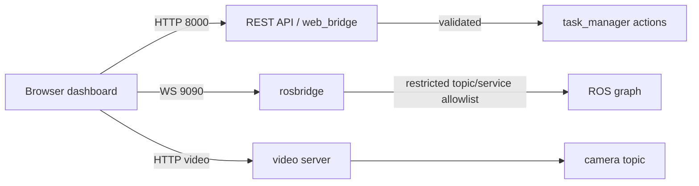

# 13 - Web Integration

## 1. Purpose
Expose robot status and controlled commands to a web dashboard without weakening robot safety.

## 2. Planned interfaces
| Interface | Port | Source/status |
|---|---|---|
| REST API (mission submit, status, config) | HTTP **8000** | planned; the reference repo's `forklift_web_bridge` is FastAPI-based and exposes `rest_port` (default 8000 in its launch file; one reference config file sets `rest_port: 8080` - **inconsistent in the reference, verify before copying**) |
| rosbridge WebSocket | **9090** | `rosbridge_server` 2.0.4 installed (candidate 2.0.8). Reference launches `rosbridge_websocket` on 9090 |
| Video | separately defined | reference uses `web_video_server` on **8080** (package present in ROS share on this machine). Final choice (MJPEG via web_video_server vs WebRTC vs other) is an open decision. Do not give REST and video the same port |
Ports are launch arguments and **unique per robot** in multi-robot runs (14). Verify actual listeners with `ss -ltnp` after launch.

## 3. Architecture

Preferred: browsers send **missions** via REST/actions (validated, rate-limited); rosbridge is used for read-mostly telemetry and tightly allow-listed commands.

## 4. Command validation and safety (mandatory)
- Never let the web publish directly to `cmd_vel` or lift commands. Motion comes only through the mission/arbitration path (05, 12) so deadman, e-stop, collision monitor and limits apply.
- Validate: schema/types, ranges (poses inside map, heights within lift limits), allowed dock ids, robot state (reject when FAULT/E-stop), idempotency/duplicate ids, size limits.
- rosbridge: use the `topics_glob`, `services_glob`, `params_glob` allow-lists (check parameter names in the installed 2.0.4 `rosbridge_websocket`), bind to localhost or a trusted interface, do not expose 9090 to untrusted networks; authentication is available in rosbridge (`authenticate` option) - evaluate; REST needs token/auth before any non-local use. **Authentication scheme is an open decision (Q-W1).**
- Emergency stop endpoint must work even if the mission layer is down and must not be disable-able remotely.
- Log every command with source and result.

## 5. Mission submission and status
`POST /missions` -> validate -> `ExecuteMission`/`ExecuteTask` goal; `GET /missions/{id}`; `POST /missions/{id}/cancel`; `GET /robot/status` (pose, battery if any, lift height, mission state, faults). Streaming via rosbridge subscriptions or Server-Sent Events/WebSocket from the bridge (TBD). Response schema documented with error codes shared with 09/12.

## 6. Tests
Unit: validators (valid/invalid/boundary). Integration: start bridge with sim; submit valid mission; invalid payload rejected with 4xx; cancel; unreachable ROS side -> 503; rosbridge allow-list blocks `/cmd_vel` publish; video stream opens; two robots on separate ports. Security smoke: confirm services bound to intended interface.
Acceptance (M13): documented endpoints behave as specified, forbidden operations are rejected, ports match config, dashboard receives status at the documented rate.

## 7. Failure modes
CORS errors; rosbridge message size/rate stalls with images (use compressed/streaming server instead); stale status after ROS node restart; port clashes; unvalidated JSON causing exceptions in action goals.

## 8. Documentation
OpenAPI spec (FastAPI generates `/docs` - verify framework choice first), port table, allow-list, auth decision, example requests/responses.
