# Mecanum Forklift AMR

*A ROS 2 Humble / Gazebo Fortress stack for a four-mecanum-wheel forklift AMR: simulation, teleoperation, SLAM, localization, Nav2 navigation, pallet docking and missions.*

**[Requirements](#requirements) | [Packages](#packages) | [Build](#build) | [Quick start](#quick-start) | [Workflow](#workflow) | [Troubleshooting](#troubleshooting)**


<p align="center">
  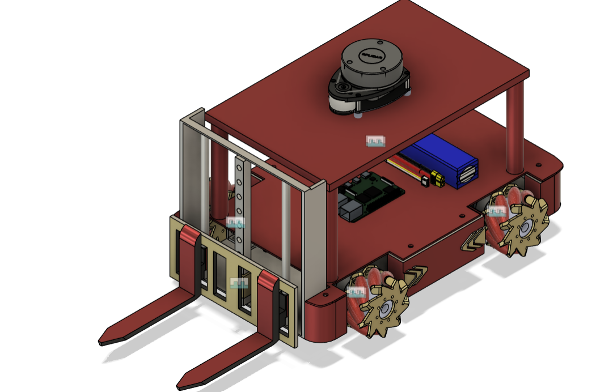
</p>

---

**A small indoor forklift AMR with four mecanum wheels, a lifting fork, a 2D LiDAR, a fork-mounted camera and an IMU. This repository simulates it in Gazebo, drives it with a keyboard or PS4 controller, maps with `slam_toolbox`, localizes with AMCL, navigates with Nav2 using a selectable MPPI, DWB or Rotation Shim controller, picks pallets from the floor or a rack using ArUco markers, and runs pick-and-drop missions. Single and multi-robot launches are included.**

> **Simulation only.** Nothing has been tested on real hardware, and simulation does not validate physical safety.

## It does things

| Mapping | Navigation |
|---|---|
| 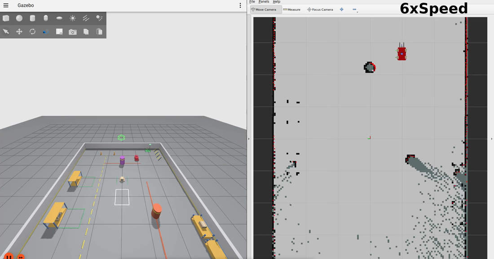 | 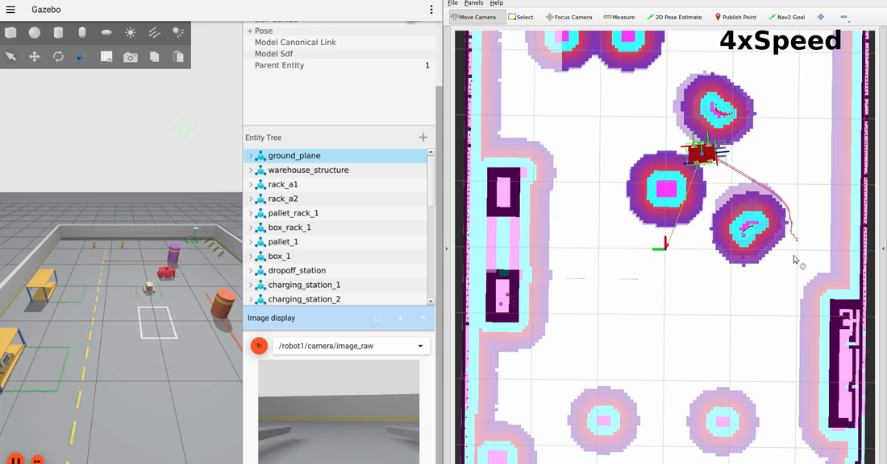 |
| **SLAM Toolbox building the warehouse map** | **Nav2 path planning around obstacles** |

| Rack docking | Pick-and-drop mission |
|---|---|
| 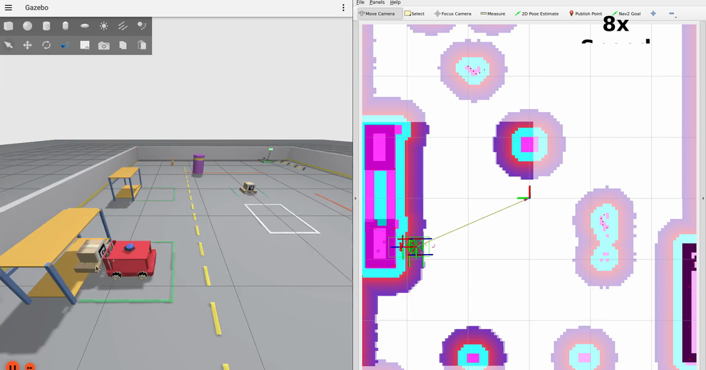 | 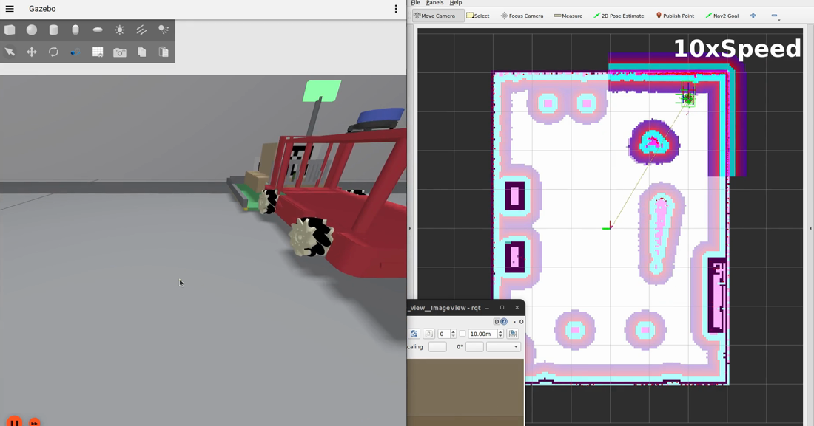 |
| **Handling a pallet at the rack** | **Delivering a pallet to the drop station** |

### Demo videos
Recorded in the `warehouse_v2` world and sped up. Each is **one demonstration run**, not a benchmark. Click a preview for the full-resolution video.

**Mapping the warehouse (6x)**

[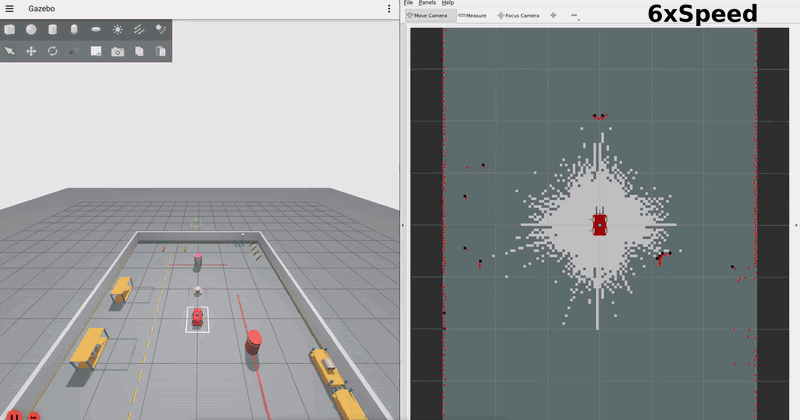](docs/videos/mapping.mp4)

**Navigation with MPPI (4x)**

[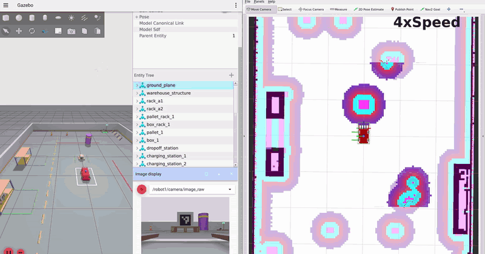](docs/videos/mppi_navigation.mp4)

**Navigation with DWB and a rack-to-rack pallet transfer (8x)**

[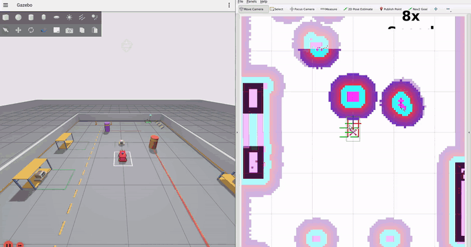](docs/videos/dwb_navigation_docking.mp4)

**Navigation with Rotation Shim and a pick-and-drop mission (10x)**

[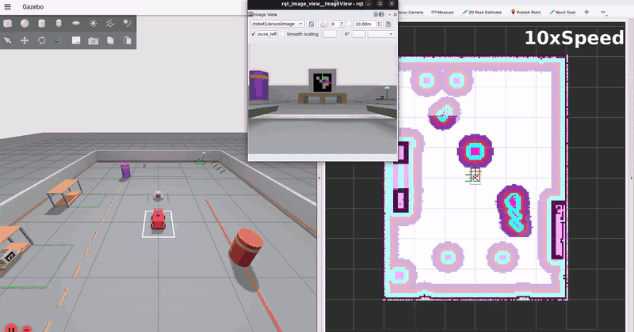](docs/videos/rotation_shim_navigation_mission.mp4)

## Contents

- [Requirements](#requirements)
- [System workflow](#system-workflow)
- [Packages](#packages)
- [Build](#build)
- [Quick start](#quick-start)
- [Workflow](#workflow)
- [TF tree](#tf-tree)
- [Key topics](#key-topics)
- [Robot summary](#robot-summary)
- [Repository layout](#repository-layout)
- [Test results](#test-results)
- [Status and roadmap](#status-and-roadmap)
- [Troubleshooting](#troubleshooting)
- [Documentation](#documentation)
- [License](#license)

## Requirements

- Ubuntu 22.04
- ROS 2 Humble ([install](https://docs.ros.org/en/humble/Installation.html))
- Gazebo Fortress ([install](https://gazebosim.org/docs/fortress/install/))
- A PS4 controller (optional, for teleoperation)
- A well-cooled machine: the full simulation is CPU-heavy

Ubuntu 24.04, ROS 2 Jazzy and Gazebo Harmonic are not supported.

```bash
sudo apt update
sudo apt install -y \
  python3-colcon-common-extensions python3-rosdep git python3-opencv python3-pip \
  ros-humble-ros-gz ros-humble-xacro ros-humble-robot-state-publisher \
  ros-humble-joint-state-publisher-gui ros-humble-rviz2 \
  ros-humble-slam-toolbox ros-humble-navigation2 ros-humble-nav2-bringup \
  ros-humble-nav2-mppi-controller \
  ros-humble-opennav-docking ros-humble-opennav-docking-msgs \
  ros-humble-twist-mux ros-humble-joy ros-humble-tf2-geometry-msgs \
  ros-humble-rosbridge-server ros-humble-web-video-server

# web layer only: the Ubuntu apt versions are too old
pip install fastapi==0.116.1 uvicorn==0.35.0
```

## System workflow

How sensors, localization, costmaps, Nav2, missions and velocity arbitration connect. Click the image for full size ([SVG version](docs/images/System_Workflow_AMR_Mecanum_wheel.svg)).

[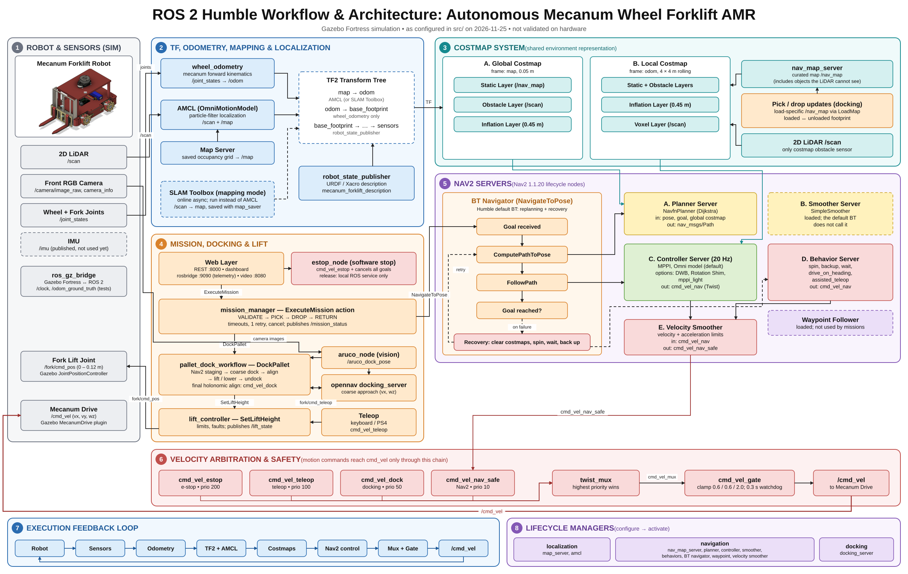](docs/images/System_Workflow_AMR_Mecanum_wheel.png)

The diagram is simplified and reflects the source and configuration files as of 2026-11-25; it was not compared with a running ROS graph. A component shown in it is not necessarily verified (see [status](docs/development/status.md)). A dashed border on a component marks one that is unused or runs in a separate mode (the TF tree box is dashed for style only).

## Packages

All package names start with `mecanum_forklift_`.

| Package | Purpose | README |
|---|---|---|
| `mecanum_forklift_description` | URDF/Xacro model, Gazebo plugins, sensors, meshes | [README](src/mecanum_forklift_description/README.md) |
| `mecanum_forklift_gazebo` | Worlds, models, robot spawn, ROS-Gazebo bridge, moving obstacles | [README](src/mecanum_forklift_gazebo/README.md) |
| `mecanum_forklift_control` | Command arbitration, safety gate, wheel odometry | [README](src/mecanum_forklift_control/README.md) |
| `mecanum_forklift_teleop` | Keyboard and PS4 teleoperation | [README](src/mecanum_forklift_teleop/README.md) |
| `mecanum_forklift_lift` | Fork lift state machine and action server | [README](src/mecanum_forklift_lift/README.md) |
| `mecanum_forklift_localization` | `slam_toolbox` mapping, AMCL, saved maps | [README](src/mecanum_forklift_localization/README.md) |
| `mecanum_forklift_navigation` | Nav2 configuration and costmap maps | [README](src/mecanum_forklift_navigation/README.md) |
| `mecanum_forklift_vision` | ArUco marker detection | [README](src/mecanum_forklift_vision/README.md) |
| `mecanum_forklift_docking` | Pallet pick and drop, floor and rack | [README](src/mecanum_forklift_docking/README.md) |
| `mecanum_forklift_task_manager` | Mission execution | [README](src/mecanum_forklift_task_manager/README.md) |
| `mecanum_forklift_web_bridge` | REST API, software e-stop, rosbridge, dashboard | [README](src/mecanum_forklift_web_bridge/README.md) |
| `mecanum_forklift_interfaces` | Custom messages, services and actions | [README](src/mecanum_forklift_interfaces/README.md) |
| `mecanum_forklift_bringup` | One-command single and multi-robot launch | [README](src/mecanum_forklift_bringup/README.md) |

## Build

```bash
git clone <repository-url> ~/mecanum_forklift_amr
cd ~/mecanum_forklift_amr

source /opt/ros/humble/setup.bash
rosdep install --from-paths src --ignore-src -r -y
colcon build
source install/setup.bash
```

These steps have not been tried on a clean machine.

## Quick start

Start the warehouse with one robot: Gazebo, RViz and the full software stack.

```bash
ros2 launch mecanum_forklift_bringup all.launch.py \
  robots:='[{"name": "robot1", "x_pose": 0.0, "y_pose": 0.0}]' \
  world:=warehouse_v2.sdf debug_image:=false
```

Then set a goal with **Nav2 Goal** in RViz.

| Argument | Default | Description |
|---|---|---|
| `world` | `simple_warehouse.sdf` | `simple_warehouse.sdf`, `warehouse_v2.sdf`; also selects the maps and docks |
| `robots` | empty | Inline fleet list. If empty, two robots start from `config/robots.yaml` |
| `controller_type` | `mppi` | `mppi`, `dwb`, `rotation_shim` (does not strafe) |
| `profile` | `full` | `light`: lighter LiDAR, AMCL and MPPI, **no camera** (so no marker-based pickup or missions) |
| `rviz` | `true` | One RViz window per robot |
| `gui` | `true` | Gazebo window |
| `dynamic_obstacles` | `false` | Move the two cylinders (`warehouse_v2` only) |
| `debug_image` | `true` | Publish the ArUco debug image (costs CPU) |
| `enable_web` | `true` | REST API, rosbridge and dashboard |

## Workflow

Run `source install/setup.bash` in every new terminal. Sections 1 to 4 start single-robot launches **without namespaces**; do not run them together with the Quick start launch.

### 1. Simulate

```bash
ros2 launch mecanum_forklift_gazebo mecanum_forklift_gazebo.launch.py world:=warehouse_v2.sdf
```

| Argument | Default | Description |
|---|---|---|
| `world` | `simple_warehouse.sdf` | `empty.sdf`, `simple_warehouse.sdf`, `warehouse_v2.sdf` |
| `x`, `y`, `z`, `yaw` | see `--show-args` | Spawn pose |
| `gui` | `true` | Gazebo window |
| `dynamic_obstacles` | `false` | Move the cylinders (`warehouse_v2` only) |

### 2. Teleoperate

```bash
ros2 run mecanum_forklift_teleop keyboard_node          # needs a real terminal
# or
ros2 launch mecanum_forklift_teleop ps4_teleop.launch.py device_id:=0
```

Keyboard: `w`/`x` forward and back, `a`/`d` strafe, `q`/`e` rotate, `r`/`f` fork up and down, `space` stop. PS4: hold **L1** to drive.

### 3. Map (SLAM)

```bash
ros2 launch mecanum_forklift_localization mapping.launch.py

# save the map
ros2 run nav2_map_server map_saver_cli -f ~/maps/my_warehouse --ros-args -p use_sim_time:=true
```

### 4. Navigate

With the `simple_warehouse` world running:

```bash
ros2 launch mecanum_forklift_navigation single_bringup.launch.py \
  map:=$(ros2 pkg prefix mecanum_forklift_localization)/share/mecanum_forklift_localization/maps/simple_warehouse.yaml \
  nav_map:=$(ros2 pkg prefix mecanum_forklift_navigation)/share/mecanum_forklift_navigation/maps/simple_warehouse_nav.yaml \
  controller_type:=mppi
```

Navigation uses two maps: `map` (the SLAM map, for AMCL) and `nav_map` (for the costmaps, which adds low objects the LiDAR cannot see). The Quick start launch selects both from `world`.

### 5. Pick and drop pallets

With the Quick start launch running, move the pallet from one rack to the other. Send the second command after the first succeeds.

```bash
ros2 action send_goal /robot1/dock_pallet mecanum_forklift_interfaces/action/DockPallet \
  "{dock_id: rack_pick_1, navigate_to_staging: true, undock_after: true}" --feedback

ros2 action send_goal /robot1/dock_pallet mecanum_forklift_interfaces/action/DockPallet \
  "{dock_id: rack_drop_2, navigate_to_staging: true, undock_after: true}" --feedback
```

| World | Pick | Drop |
|---|---|---|
| `simple_warehouse` | `pallet_pick_1` (`_2`, `_3` untested) | `pallet_drop_1` (`_2` to `_4` untested) |
| `warehouse_v2` | `pallet_pick_1` (floor), `rack_pick_1` | `pallet_drop_1` to `_3` (floor), `rack_drop_1`, `rack_drop_2` |

In `warehouse_v2`, floor drops accept only `pallet_1`. There is no rack occupancy check: use `rack_drop_1` only when that rack is empty.

### 6. Run a mission

Restart the launch first so the pallets are back in place.

```bash
ros2 action send_goal /robot1/execute_mission mecanum_forklift_interfaces/action/ExecuteMission \
  "{mission_id: demo1, mission_type: PALLET_TRANSPORT, pick_dock_id: pallet_pick_1, drop_dock_id: pallet_drop_1, return_pose: {header: {frame_id: map}, pose: {orientation: {w: 1.0}}}}" --feedback
```

`return_pose` sends the robot back to the map origin; leave it out to stay at the drop.

### 7. Web interface

The dashboard is at `http://127.0.0.1:8000/`. The REST API needs the token in `~/.config/mecanum_forklift/web_token`. rosbridge uses port 9090 and has no authentication; keep the default local address unless the network is trusted. Video (port 8080) is off by default (`enable_video`). See the [`web_bridge` README](src/mecanum_forklift_web_bridge/README.md).

### 8. Multiple robots

Edit `src/mecanum_forklift_bringup/config/robots.yaml`, rebuild that package, then:

```bash
ros2 launch mecanum_forklift_bringup all.launch.py profile:=light
```

Each robot gets its own namespace, TF tree and ports. The `light` profile has no camera, so marker-based pickup and missions need the `full` profile. Two-robot isolation is **not yet tested**.

## TF tree

```text
map -> odom -> base_footprint -> base_link -+-> wheel links
                                            +-> lidar_link
                                            +-> imu_link
                                            +-> fork_link -> front_camera_link
```

The camera also has an optical frame.

| Transform | Publisher |
|---|---|
| `map -> odom` | AMCL (or `slam_toolbox` when mapping) |
| `odom -> base_footprint` | `wheel_odometry` (the only source) |
| `base_footprint -> base_link -> other links` | `robot_state_publisher` |

With the bringup launch, frame names stay the same and each robot publishes on `/<robot>/tf` and `/<robot>/tf_static`.

## Key topics

| Topic | Type | Source |
|---|---|---|
| `/cmd_vel_teleop` | `geometry_msgs/Twist` | Keyboard or PS4 |
| `/cmd_vel_dock` | `geometry_msgs/Twist` | Docking |
| `/cmd_vel_nav_safe` | `geometry_msgs/Twist` | Nav2 velocity smoother |
| `/cmd_vel_estop` | `geometry_msgs/Twist` | Software e-stop |
| `/cmd_vel` | `geometry_msgs/Twist` | `cmd_vel_gate` (the only publisher) |
| `/odom` | `nav_msgs/Odometry` | `wheel_odometry` |
| `/odom_ground_truth` | `nav_msgs/Odometry` | Gazebo (testing only) |
| `/scan` | `sensor_msgs/LaserScan` | Gazebo |
| `/camera/image_raw` | `sensor_msgs/Image` | Gazebo |
| `/imu` | `sensor_msgs/Imu` | Gazebo |
| `/aruco_dock_pose` | `geometry_msgs/PoseStamped` | `aruco_node` |
| `/lift_state` | `mecanum_forklift_interfaces/LiftState` | `lift_controller` |
| `/fork/cmd_pos` | `std_msgs/Float64` | `lift_controller` |

Velocity path: sources -> `twist_mux` (e-stop > teleop > docking > navigation) -> `cmd_vel_gate` (timeout and speed limits) -> `cmd_vel`. With the bringup launch, topics are under `/<robot>/`.

## Robot summary

Values from the simulation model (`urdf/mecanum_forklift.urdf.xacro`). They have not been checked against a physical robot.

| Parameter | Value |
|---|---|
| Type | Indoor mecanum forklift AMR (holonomic) |
| Chassis (L x W x H) | 0.407 x 0.254 x 0.204 m, 0.02 m ground clearance |
| Drive wheels | 4 mecanum, radius 0.039 m, wheelbase 0.22 m |
| Fork | Prismatic lift, 0 to 0.12 m travel |
| Mass (model) | 5 kg chassis, 0.3 kg per wheel, 0.5 kg fork |
| Sensors | 1 x 2D LiDAR (YDLidar X2 model), 1 x camera on the fork, 1 x IMU |

CAD design:

| Front | Side | Top |
|---|---|---|
| 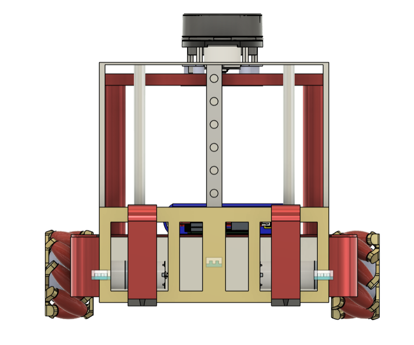 | 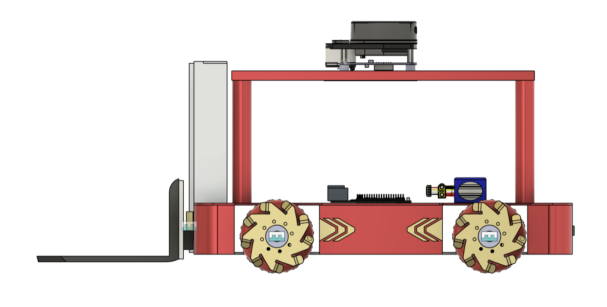 | 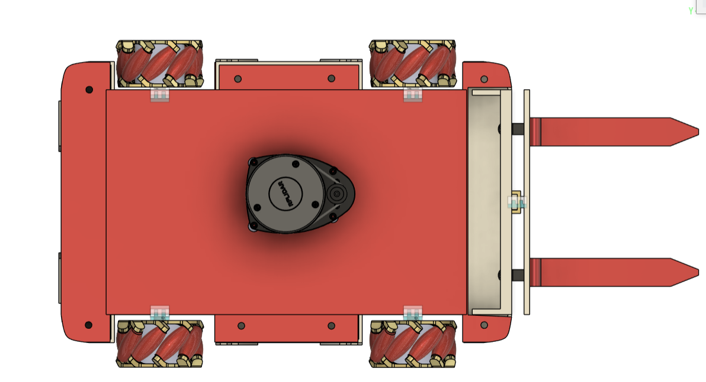 |

## Repository layout

```text
mecanum_forklift_amr/
├── README.md
├── docs/                    # requirements, architecture, decisions, status, test reports, media
├── tools/                   # media capture helper
└── src/
    ├── mecanum_forklift_description/
    ├── mecanum_forklift_gazebo/
    ├── mecanum_forklift_control/
    ├── mecanum_forklift_teleop/
    ├── mecanum_forklift_lift/
    ├── mecanum_forklift_localization/
    ├── mecanum_forklift_navigation/
    ├── mecanum_forklift_vision/
    ├── mecanum_forklift_docking/
    ├── mecanum_forklift_task_manager/
    ├── mecanum_forklift_web_bridge/
    ├── mecanum_forklift_interfaces/
    └── mecanum_forklift_bringup/
```

## Test results

Measured in simulation in the `simple_warehouse` world; reports are in [`docs/testing/`](docs/testing/).

| Area | Result |
|---|---|
| Odometry against ground truth | 0.1 mm or less over single motions, circles and squares |
| AMCL localization | RMS 33-34 mm / 0.25 deg |
| MPPI navigation | 20/20 goals reached, 17/20 within 5 cm / 5 deg, no contacts |
| DWB navigation | 9/10 goals |
| Pallet pick and carry | 20/20 trials, docking error 6.6 mm / 0.72 deg or less |
| Full missions | 11/11; pallet 4.0-6.7 cm from the drop pad centre |
| Web layer | 9/9 integration cases |

**`warehouse_v2` is newer and not yet formally tested.** The videos show it without recorded accuracy or success rates.

Unit and lint tests:

```bash
colcon test && colcon test-result --verbose
```

## Status and roadmap

Implemented in simulation: robot model, Gazebo worlds, teleoperation, odometry, SLAM, AMCL localization, Nav2 navigation, fork lift, ArUco docking, missions, web layer and multi-robot bringup. Milestone details: [status](docs/development/status.md) and [roadmap](docs/development/roadmap.md).

Still open:

- [ ] Formal tests in `warehouse_v2`: localization, navigation, floor docks and rack docks
- [ ] Measured moving-obstacle avoidance (cylinder path tracking has not passed its 5 cm check)
- [ ] Navigation trials with Rotation Shim
- [ ] Two-robot isolation tests
- [ ] Hardware drivers and real-robot calibration and validation

Known limitations:

- Rack drops have no marker to align with, so depth accuracy depends on AMCL. The calculated tolerance is about 5 cm short or 5.8 cm too deep.
- With two robots, the ArUco node has exited when no camera images arrived for 10 s (suspected overload, not confirmed).
- Payload, sensor noise, wheel slip and stopping distances are unvalidated.

Run physical hardware only after testing speed limits, command timeouts and a hardware emergency stop. The software e-stop does not replace it.

## Troubleshooting

| Problem | Fix |
|---|---|
| Package or launch file not found | `source install/setup.bash` in every new terminal |
| A change to YAML, a map or a world has no effect | Rebuild the package, then relaunch |
| Launch stops with "map not found" | Add `maps/<world>.yaml` and `maps/<world>_nav.yaml`, rebuild, or use `enable_navigation:=false` |
| Cylinders do not move | Use `world:=warehouse_v2.sdf dynamic_obstacles:=true` |
| Robot ignores navigation goals while the keyboard node runs | Stop the keyboard node: its zero commands take priority over navigation |
| Duplicate nodes or odd behaviour after Ctrl-C | Check for leftover processes: `ps -eo pid,cmd \| grep -E "ign gazebo\|twist_mux"` |
| `aruco_node` exits with code 3 | No camera images arrived. Reduce load: one robot, `debug_image:=false`, `rviz:=false`, `gui:=false` |
| Simulation is slow or the computer overheats | `gui:=false`, `rviz:=false`, one robot |
| PS4 controller does nothing | Hold L1; check `ros2 topic echo /joy` and `config/ps4.yaml` |

More detail is in each package README.

## Documentation

- [Architecture](docs/architecture/)
- [Requirements](docs/requirements/requirements.md)
- [Design decisions](docs/decisions/)
- [Test reports](docs/testing/)
- [Photo and video shot sheet](docs/media/README.md)

Status terms used in these documents: *implemented, built, tested, verified, blocked*.

## Acknowledgements

- [boyloy21/autonomous-mini-forklift](https://github.com/boyloy21/autonomous-mini-forklift): architectural reference (differential drive).
- [ROS2-AMR-Manipulation-Course/trailobot_amr](https://github.com/ROS2-AMR-Manipulation-Course/trailobot_amr): README layout and multi-robot bringup structure.

## License

Licensed under [Apache-2.0](LICENSE), as declared in the ROS package manifests.
